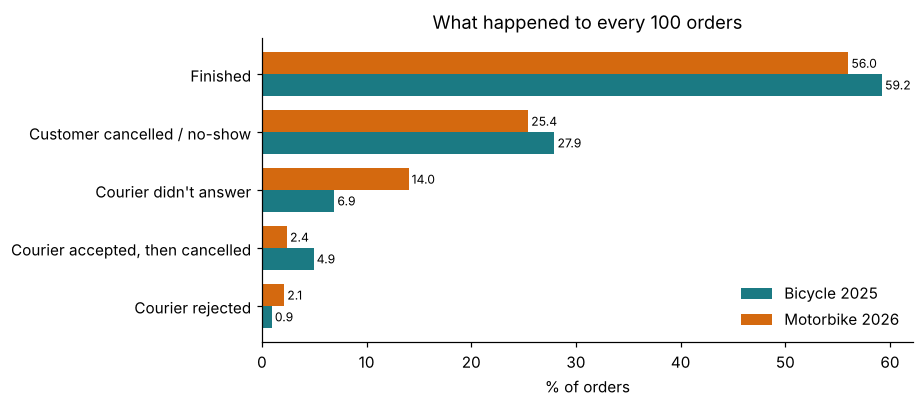
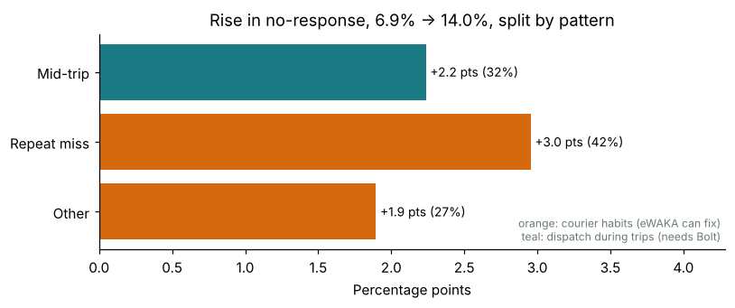

# Why motorbike couriers miss orders, and what it costs them

**Bolt Send × eWAKA courier performance · revised analysis**
Based on Team 7's entry in the Santa Clara University MSBA Analytics Showdown (Fall 2026). This is a revised version made after judging.

## The question

> What is the biggest reason motorbike couriers fail to complete orders, and how much more would a courier earn per day if it were reduced?

eWAKA leases electric motorbikes to couriers who deliver for Bolt Send in Nairobi. Motorbikes finish **twice as many orders per online hour** as bicycles did (1.50 vs 0.73), yet their completion rate is **lower** (56.0% vs 59.2%). This project finds out why.

## Key findings

**1. Orders are lost before couriers accept them.**
The outcome that changed most is *courier didn't answer*: **6.9% → 14.0%** of orders. Once a courier accepts, motorbikes finish more orders than bicycles did (66.8% vs 64.3%).



**2. It is not mainly because couriers are too busy.**
Counting only offers a courier answered in the previous hour, no-response rises just from 12.7% (least busy) to 16.0% (busiest), about 3 points of the 7-point rise.

**3. Three patterns explain the rise, in roughly equal parts.**
- **Mid-trip offers:** sent while the courier is still on a trip. Missed 30% of the time; a quarter of all misses.
- **Repeat misses:** within 10 minutes of an earlier miss. After a miss, Bolt sends another offer within 2 minutes half the time, and half of those are missed too.
- **Other:** ordinary offers to free couriers.



**4. Each miss costs the courier money.**
A typical courier-day earns KSh 1,860 (gross) and misses about 2 offers, about **14% of daily income**. Bringing misses back to 2025 levels would raise completion from 56% to 62%: **about +1 order and +KSh 180 a day (+10%)**.

## Recommendations, in order

| # | Fix | Why first / later |
|---|---|---|
| 1 | **"Answer it or turn it off"**: train couriers that not answering counts as a no; call after 2 misses in a row; weekly scorecard showing lost income | Covers repeat and other misses, about **two-thirds of the rise**. eWAKA can start without Bolt. |
| 2 | **Ask Bolt to stop sending offers during trips** | Covers the mid-trip third. Needs Bolt. |
| 3 | **Pay KSh 100 per verified customer no-show** | Couriers get nothing today. About KSh 19,000 for 4 months, under 2% of fares. |
| — | Add 1–2 afternoon couriers **only if** a gap remains after a few weeks | About 37 courier-hours needed a day vs 28 online, an upper bound. |

**Courier Performance Score = Reliability × Productivity**, where reliability is the share of offers the courier kept (only what they control) and productivity is finished orders per online hour relative to the fleet median. Multiplying stops couriers from scoring well by staying online and ignoring offers.

## What changed after judging

The judges' questions found three problems in the original submission, all corrected here:

| Original claim | Problem | Revised |
|---|---|---|
| "Too many orders at once" causes misses | Load counted missed offers, and Bolt re-sends after a miss | Busyness explains about 3 of the 7 points |
| Mid-trip offers are 13.7% of misses | The mid-trip flag reset after any unfinished order | **25.5%** after the fix |
| "28 of 74 courier-hours" at peak | Divided all offers by a finished-order capacity (units didn't match) | **28 of 37**: a small gap, so more couriers comes last |

The claim that suspensions cause couriers to leave was also withdrawn, since the data can't show cause.

## Repository

**Slides:** [8-slide summary (PDF)](slides/boltsend_ewaka_revised.pdf)

```
slides/boltsend_ewaka_revised.pdf         8-slide summary (also .pptx)
notebooks/completion_gap_analysis.ipynb   full analysis with saved outputs
images/                                   charts used in this README
data/                                     not included (see data/README.md)
original_submission/                      Team 7's competition entry, before judging
```

The original competition deck, notebooks and models are kept in [`original_submission/`](original_submission/README.md), unchanged except for anonymized courier IDs, with a list of the issues corrected here.

To re-run: place the two eWAKA files in `data/`, install `requirements.txt`, and run the notebook. Outputs are saved, so it can be read on GitHub without running.

## Data and limitations

Bolt Send rider history and performance files from eWAKA, January 2025 – August 2026. Main comparison: bicycles May–Aug 2025 (45,947 orders, 213 couriers) vs motorbikes May–Aug 2026 (9,086 orders, 21 couriers), optional rides excluded.

- Bicycles and motorbikes are compared across different years, with only 21 motorbike couriers.
- No order IDs, so a missed order can't be linked to a later re-send.
- No app status or location, so trip times are inferred from order and fare-finalised times.
- Income is gross: before Bolt's commission and eWAKA's deductions.

## Credits

Original competition analysis: Team 7, Sinhye (Sherry) Kim, Yan Wu, Wei-Chia Lin (Vivien), Ethan Casey.
I led the analysis and built the slide deck for the original submission, and made this revision after judging.
Model C (demand forecast) and the rider allocation analysis in `original_submission/` are by Ethan Casey, shared with his permission.

**Tools:** Python (pandas, NumPy, matplotlib)
